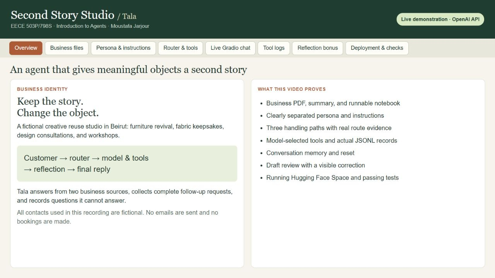

# Second Story Studio / Tala

**Keep the story. Change the object.** A fictional Beirut studio helps customers redesign meaningful furniture and textiles. Tala is its OpenAI-powered virtual concierge.

**[Download the narrated demonstration](https://github.com/MoustafaJarjour/Second-Story-Studio/raw/refs/heads/main/demo/demo.mp4)** · **[Try the deployed Hugging Face Space](https://huggingface.co/spaces/MoustafaJarjour/second-story-studio)** · **[Submission checklist](SUBMISSION_CHECKLIST.md)**

[](https://github.com/MoustafaJarjour/Second-Story-Studio/raw/refs/heads/main/demo/demo.mp4)

The **4:54** video demonstrates the required business artifacts, persona and instructions, all three routing paths, real model-selected tool calls, saved records, conversation memory and reset, logged reflection, and the public deployment. English captions are burned into the video and supplied separately in [WebVTT format](demo/demo.en.vtt). Chapter timestamps are listed below. GitHub’s file viewer does not preview this MP4; download it to play locally.

## Run locally

Use Python 3.12. From the repository root:

```powershell
python -m pip install -r requirements.txt
Copy-Item .env.example .env
```

Edit the local `.env` and set `OPENAI_API_KEY` to your own key. Keep `OPENAI_MODEL=gpt-4.1-mini`, then run:

```powershell
python app.py
```

Open `http://127.0.0.1:7860`. OpenAI API billing is separate from a ChatGPT subscription. `.env` and normal customer logs are ignored by Git; no key is included in this repository. On Spaces, the key is a server-side Secret. See [deployment notes](huggingface_guide.md).

For Jupyter or Colab, open [business_agent.ipynb](business_agent.ipynb) with this repository as its working directory and the `me/` folder alongside it. The notebook contains the implementation in clearly labelled steps. Its live-call and app-launch flags default to `False`. After setup, set `RUN_REFLECTIVE_CHAT = True` in the last cell to launch the interface with reflection. Run one app instance per port.

## Assignment artifacts

| Requirement | Implementation and evidence |
| --- | --- |
| Business summary | [me/business_summary.txt](me/business_summary.txt); [summary.txt alias](me/summary.txt) |
| Business PDF | [me/about_business.pdf](me/about_business.pdf), two pages covering mission, services, team, and value proposition |
| Main notebook | [business_agent.ipynb](business_agent.ipynb), 22 code cells validated successfully |
| Distinct persona and instructions | Separate labelled notebook blocks and [agent_identity.md](agent_identity.md) |
| Three-intent router | [router.py](router.py): classifier, handler dispatch, pending lead state, and mixed-message actions |
| Required tools | [business_tools.py](business_tools.py), [MCP-style schemas](tool_schemas.json), [tool documentation](tools.md) |
| Model interaction and memory | [agent_interaction.py](agent_interaction.py): current OpenAI Python SDK Chat Completions, model-selected functions, tool receipts, and session history |
| Business grounding | [chat_setup.py](chat_setup.py) loads summary and PDF; [system_prompt.txt](system_prompt.txt) is the assembled prompt |
| Gradio chatbot | [gradio_interface.py](gradio_interface.py) and [app.py](app.py), with per-conversation state and New conversation reset |
| Private API key | [.env.example](.env.example) is the empty template; the real `.env` is excluded |
| Reflection bonus | [reflection.py](reflection.py), enabled by default in `app.py`; actual [draft/final logs](demo/evidence/reflections.jsonl) |
| Spaces bonus | [Running public deployment](https://huggingface.co/spaces/MoustafaJarjour/second-story-studio); [recorded verification](demo/evidence/deployment.json) |

The assignment's requested `me/` directory structure is preserved. The API uses `client.chat.completions.create(...)`, the current SDK equivalent of the assignment's `openai.ChatCompletion` flow.

## Router and tools

`route_message` classifies into `general_question`, `lead_collection`, or `feedback_or_unanswered`. `route_and_dispatch` selects the handling plan. The model receives the conversation, business knowledge, and tool definitions, then chooses whether to call a tool. `dispatch_tool_call` validates and invokes the named function, and its result is returned to the model.

- `record_customer_interest(email, name, message)` saves a complete follow-up request to `logs/leads.jsonl`.
- `record_feedback(question)` saves a business question that cannot be answered from the supplied knowledge to `logs/unanswered_questions.jsonl`.
- `record_customer_feedback(feedback)` separately saves suggestions and complaints to `logs/customer_feedback.jsonl`.

The third tool keeps customer feedback separate from unanswered questions. Each tool returns `{success, message}`. A price question alone does not require contact details. Incomplete leads retain context across turns and ask for missing fields. A saved lead does not send email, confirm a booking, or make a sale.

## Reflection and demonstration evidence

Before display, the draft receives one additional model check against the system instructions, conversation, and tool receipts. The reviewer can retain or revise it. `logs/reflections.jsonl` records `original_draft`, `revised_reply`, status, issues, changed flag, and log success. The reviewed final reply enters conversation memory. A failed review produces a safe retry reply; reflection is a lightweight check and does not guarantee perfect compliance.

The recording uses real Gradio/OpenAI exchanges with the fictional customer Dana Demo (`dana.demo@example.com`). [Actual turn events](demo/evidence/events.json) include routes, tool arguments and results, and review records. [Lead](demo/evidence/leads.jsonl), [unknown question](demo/evidence/unanswered_questions.jsonl), and [customer suggestion](demo/evidence/customer_feedback.jsonl) files show successful writes. These intentionally included demonstration records contain no real customer data.

A separate, clearly labelled controlled reflection test supplies a deliberately incorrect draft. Its correction is a real model response. This fixture makes changes visible without claiming the ordinary model spontaneously invented those facts. Normal chat turns also pass through reflection before their replies appear.

The video is an edited browser-only screen recording with offline synthetic narration. Processing pauses are condensed, static evidence is held for readability, and the audit views are recorded after the interactions. Responses and log records are actual outputs. The local recording companion uses the deployed agent code; the final hosted segment is recorded separately on the public Space. The companion is an assessment aid and does not change the deployed app.

To reproduce the local evidence viewer (optional; sending chat messages uses API credits):

```powershell
python demo/record_demo.py
```

Open the live Gradio app at `http://127.0.0.1:7862` and the read-only audit viewer at `http://127.0.0.1:8891`. The reflection-test button makes one real review request. Demonstration logs are stored separately under `demo/evidence/` and subsequent runs append to them.

## Validation

```powershell
python -m unittest discover -p "test_*.py"
```

**52 offline tests passed.** They cover routing, tool validation and protocol, business grounding, conversation isolation, retries, and reflection errors. [Saved test output](demo/evidence/test_results.txt). All **22 notebook code cells** also executed successfully with live calls and Gradio launch disabled: [notebook validation](demo/evidence/notebook_validation.json). The video additionally demonstrates real API calls and successful tool writes.

The public Space was verified Running on 17 October 2026 and answered consultation and workshop questions. It uses ZeroGPU hosting with OpenAI inference. The unused `@spaces.GPU` startup marker is never invoked by chat or reflection; automatic GPU wrapping is disabled. Runtime logs on Spaces are ephemeral and are not automatically committed to either repository.

Source was copied from deployed Space revision `e941bb411d7225d940bd1a7efe7f82253a980089`; submission documentation, video, and synthetic evidence were added here. [Provenance and core file hashes](demo/evidence/provenance.json).

## Video chapters

- **00:00** — Overview: an agent-powered business assistant
- **00:25** — Required business files and runnable notebook
- **00:52** — Persona and instructions: clearly separated
- **01:18** — Three routes and distinct tool contracts
- **01:46** — Live general question: grounded answer, no lead logging
- **02:09** — Live lead collection and conversation memory
- **02:36** — Unknown question, separate suggestion, and actual logs
- **03:01** — Reflection bonus: original draft and real correction
- **03:32** — New conversation resets short-term memory
- **03:52** — Bonus: the deployed Hugging Face Space
- **04:18** — Verification and complete submission
